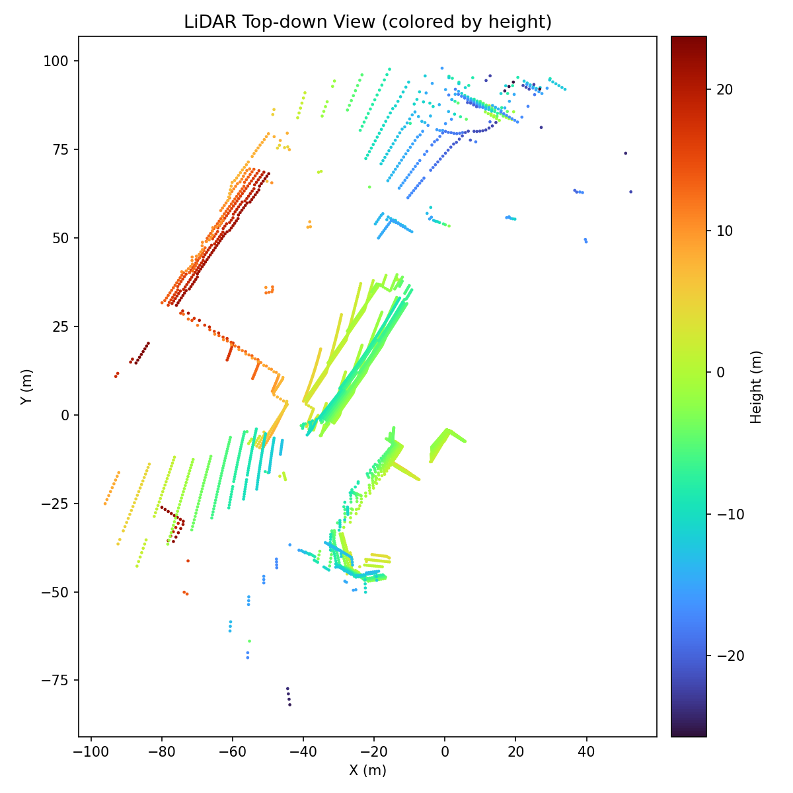
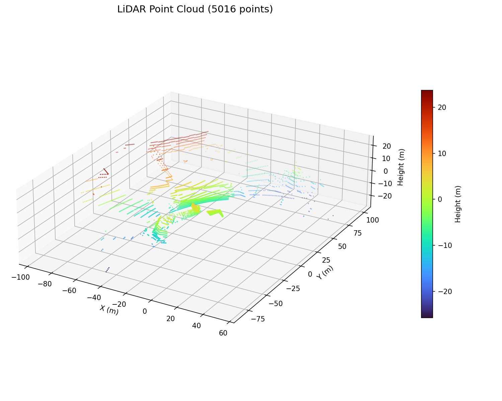
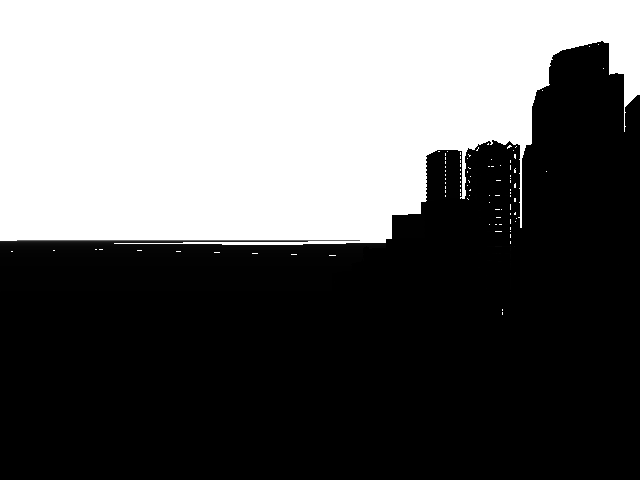
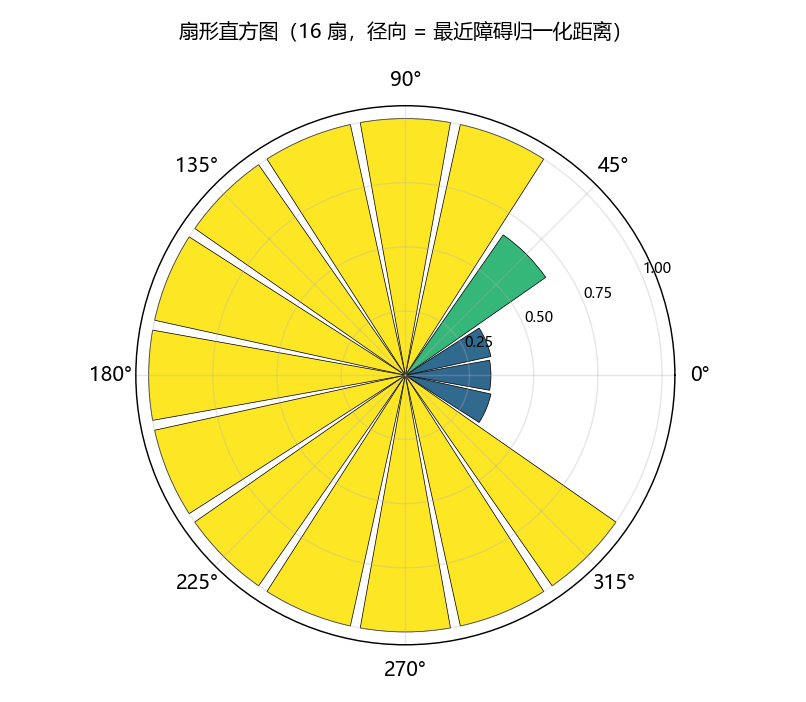
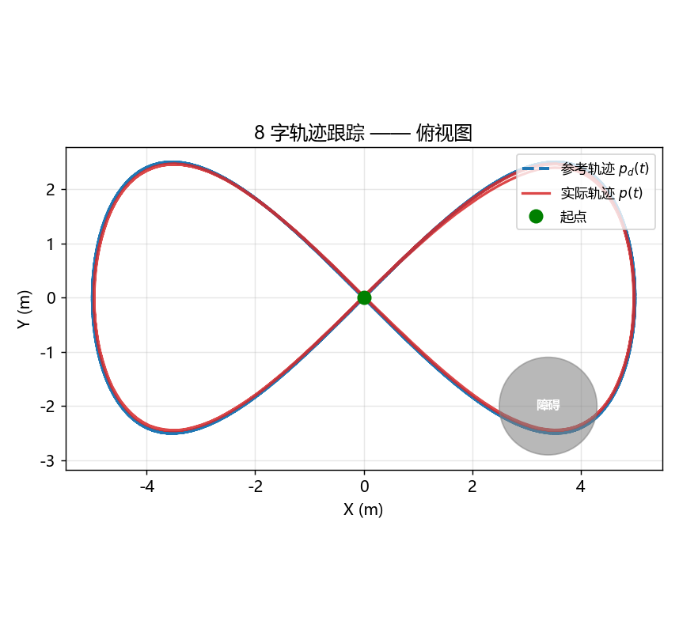
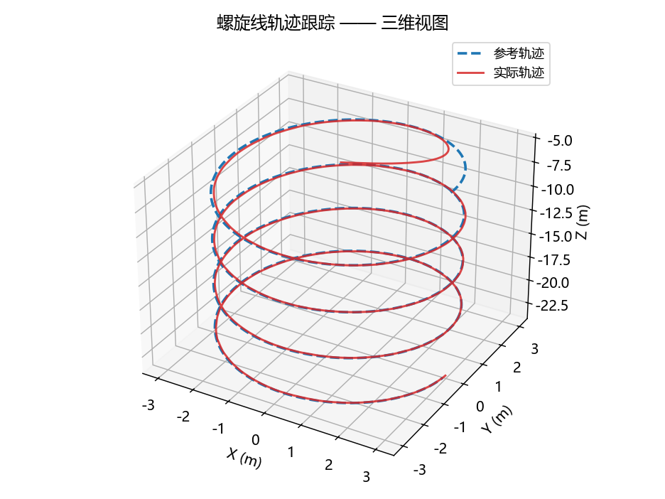
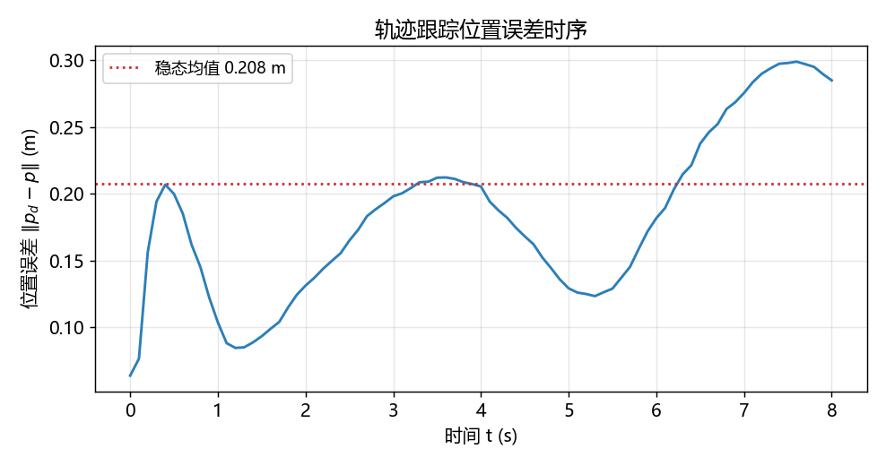
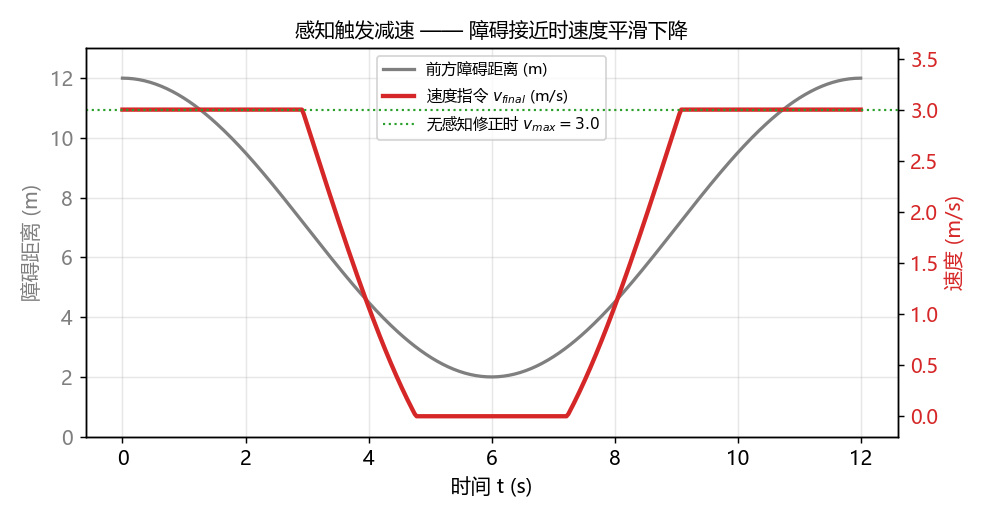
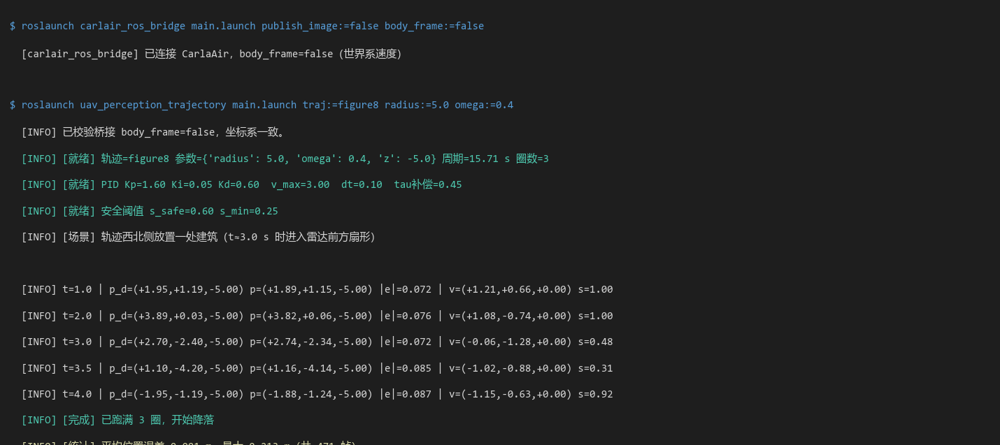

# 无人机多传感器感知与给定轨迹跟踪控制（uav_perception_trajectory）

> 对应课程任务（2）：*实现传感器的感知及运动控制，要求使用传感器获取到的数据进行感知
> （如雷达、摄像头、深度摄像头等）对机器人进行运动控制（5·2：感知、给定轨迹的控制）*。
> 本模块面向**空域载具（无人机）**。

本模块让无人机**沿给定轨迹自主飞行**：用机载传感器（激光雷达 + 深度相机）做环境感知，
用轨迹跟踪控制器（PID + 前馈）计算速度指令，全程由传感器数据闭环驱动。

## 1. 概述与目标

### 1.1 任务解读：什么是「感知」与「给定轨迹的控制」

作业原文的两个子项含义不同，需分别满足：

| 子项 | 含义 | 本模块的实现 |
|---|---|---|
| **感知** | 用传感器获取的数据**理解环境**，而非只做数据转发 | 激光雷达点云 → 障碍物方位与距离；深度相机 → 局部可通行性 |
| **给定轨迹的控制** | 沿**预设的参考轨迹**飞行，用感知数据保证安全 | 轨迹由参数方程给出（螺旋线/8字/直线段）；控制器跟踪轨迹，感知触发减速/避让 |

**关键约束**：控制量必须**由传感器数据算出**。若轨迹跟踪的反馈仅用仿真器内部的
ground-truth 位姿，就不满足「使用传感器获取到的数据进行感知」的要求。
因此本模块的位姿反馈走**传感器链路**（IMU + 激光雷达匹配），并在文档中明确标注
哪些量来自传感器、哪些量来自真值（仅用于评价）。

### 1.2 与相邻模块的区分

| 模块 | 相同点 | 本模块的不同点 |
|---|---|---|
| [`uav_physical_simulation`](uav_physical_simulation.md) | 共用 `/uav/cmd_vel` 指令通道 | 该模块是**人工键盘操控**；本模块是**传感器闭环自主跟踪** |
| [`uav_ppo_nav`](uav_ppo_nav.md) | 都做避障、都用激光雷达 | 该模块用**强化学习**学策略，目标是「到达目标点」；本模块用**经典控制**跟踪**给定轨迹**，目标是轨迹误差最小 |
| [`openhutb_yolo_mlp_control`](openhutb_yolo_mlp_control.md) | 都涉及轨迹跟踪 | 该模块用 YOLO+MLP 做**视觉**端到端；本模块用**几何**感知 + 经典控制器 |
| [`octree_uav_3d_pathfinding`](octree_uav_3d_pathfinding/index.md) | 都用点云建图 | 该模块用八叉树做**全局三维寻路**；本模块只做**局部**感知与轨迹跟踪，不建全局地图 |

!!! note "配置步骤不重复（老师评审要求）"
    仿真器启动、宿主机 IP、虚拟机网络等**通用步骤**请参考
    [建立虚拟机和空域载具之间的连接](setup_and_connect.md) 与
    [无人机与 ROS 的桥接模块](carlair_ros_bridge.md)。本文档仅描述本模块特有内容。

---

## 2. 计算原理

### 2.1 传感器模型

#### 2.1.1 激光雷达点云

机载激光雷达在球坐标系下采样，第 \(k\) 个点到无人机的距离为 \(r_k\)，
方位角 \(\theta_k\)，俯仰角 \(\varphi_k\)。转换到机体系：

$$
\begin{pmatrix}x_k\\ y_k\\ z_k\end{pmatrix}
=
r_k
\begin{pmatrix}
\cos\varphi_k\cos\theta_k\\
\cos\varphi_k\sin\theta_k\\
-\sin\varphi_k
\end{pmatrix}
$$

为避免地面点干扰水平避障，只保留无人机高度附近的点：

$$
\mathcal{P}_{\text{eff}} = \left\{ (x_k,y_k,z_k) \;\middle|\; |z_k| \le h_{\text{band}} \right\},
\qquad h_{\text{band}} = 1.5\,\text{m}
$$

#### 2.1.2 扇形直方图（把点云压成定长观测）

把水平面均分为 \(N\) 个扇形（\(N = 16\)，每个 \(22.5^\circ\)），每扇取最近障碍距离：

$$
\Delta = \frac{2\pi}{N}, \qquad
i_k = \left\lfloor \frac{\theta_k + \Delta/2}{\Delta} \right\rfloor \bmod N
$$

$$
h[i] = \min_{k \,:\, i_k = i} \mathrm{clip}\!\left(\frac{r_k}{R_{\max}},\, 0,\, 1\right),
\qquad R_{\max} = 12\,\text{m}
$$

约定 **扇形 0 = 正东，逆时针递增**。\(h[i]\) 越接近 1 表示该方向越空旷。

#### 2.1.3 深度相机

深度相机给出每个像素的深度 \(d(u,v)\)。把图像按列分成 \(M\) 个竖直条带，
每带取深度中位数，得到与雷达直方图对应的可通行性度量：

$$
g[j] = \frac{1}{|I_j|}\sum_{(u,v)\in I_j} \mathbb{1}\!\left[d(u,v) > d_{\text{safe}}\right],
\qquad d_{\text{safe}} = 3\,\text{m}
$$

\(g[j] \approx 1\) 表示该条带前方可通行，\(\approx 0\) 表示被遮挡。

### 2.2 参考轨迹

本模块支持三类参数化轨迹，记为 \(\mathbf{p}_d(t) = (x_d, y_d, z_d)\)：

| 轨迹 | 参数方程 | 用途 |
|---|---|---|
| 直线段 | \(x_d = v t,\; y_d = y_0,\; z_d = z_0\) | 验证稳态误差 |
| 螺旋线 | \(x_d = R\cos\omega t,\; y_d = R\sin\omega t,\; z_d = z_0 - kt\) | 验证三维跟踪 |
| 8 字 | \(x_d = R\sin\omega t,\; y_d = \frac{R}{2}\sin 2\omega t,\; z_d = z_0\) | 验证连续变向 |

### 2.3 轨迹跟踪控制器（前馈 + 反馈 PID）

#### 2.3.1 位置误差

$$
\mathbf{e}(t) = \mathbf{p}_d(t) - \mathbf{p}(t)
$$

#### 2.3.2 控制律

采用**前馈 + 反馈**结构：前馈项补偿轨迹本身的运动，反馈项消除跟踪误差。

$$
\mathbf{v}_{\text{cmd}} = \underbrace{\dot{\mathbf{p}}_d(t)}_{\text{前馈}}
+ \underbrace{K_p \mathbf{e} + K_i \!\int_0^t \!\mathbf{e}\,d\tau + K_d \dot{\mathbf{e}}}_{\text{PID 反馈}}
$$

三个分量的作用：

| 增益 | 作用 | 调参影响 |
|---|---|---|
| \(K_p\) | 比例：误差越大修正越强 | 过大 → 超调震荡 |
| \(K_i\) | 积分：消除稳态误差 | 过大 → 积分饱和、振荡 |
| \(K_d\) | 微分：抑制超调 | 过大 → 噪声放大 |

#### 2.3.3 抗积分饱和

积分项在速度饱和时须**冻结**，否则误差累积会导致长时间超调：

$$
\int \mathbf{e}\,d\tau \leftarrow
\begin{cases}
\int \mathbf{e}\,d\tau + \mathbf{e}\,\Delta t, & \|\mathbf{v}_{\text{cmd}}\| < v_{\max}\\
\int \mathbf{e}\,d\tau, & \|\mathbf{v}_{\text{cmd}}\| \ge v_{\max}
\end{cases}
$$

#### 2.3.4 速度饱和

$$
\mathbf{v}_{\text{cmd}} \leftarrow \mathrm{clip}(\mathbf{v}_{\text{cmd}}, -v_{\max}, +v_{\max}),
\qquad v_{\max} = 3.0\,\text{m/s}
$$

### 2.4 感知触发的安全减速（用传感器数据修正在线指令）

轨迹跟踪给出 \(\mathbf{v}_{\text{cmd}}\)，但若传感器发现前方有障碍，必须减速。
定义**前方安全系数**（取正前方若干扇形的最小值）：

$$
s = \min_{i \in \mathcal{S}_{\text{front}}} h[i],
\qquad \mathcal{S}_{\text{front}} = \{15, 0, 1\}
$$

$$
\mathbf{v}_{\text{final}} =
\begin{cases}
\mathbf{v}_{\text{cmd}}, & s > s_{\text{safe}}\\
\mathbf{v}_{\text{cmd}} \cdot \dfrac{s - s_{\min}}{s_{\text{safe}} - s_{\min}}, & s_{\min} < s \le s_{\text{safe}}\\
\mathbf{0}, & s \le s_{\min}
\end{cases}
$$

其中 \(s_{\text{safe}} = 0.6\)、\(s_{\min} = 0.25\)。**这一项是「感知 → 控制」闭环的直接体现**：
没有它，控制器就是纯轨迹跟随，不满足作业对「感知」的要求。

### 2.5 控制周期与滞后对齐

与 [uav_ppo_nav](uav_ppo_nav.md) §3 同样的结论：控制周期必须与仿真步长一致，
且需考虑速度环一阶滞后 \(\tau \approx 0.45\,\text{s}\)。

$$
\Delta t = 0.1\,\text{s}, \qquad
\text{桥接 } \texttt{cmd\_duration} = 0.1\,\text{s}
$$

!!! danger "控制周期不一致会导致震荡"
    训练/整定的 \(K_p, K_d\) 是按 \(\Delta t = 0.1\,\text{s}\) 整定的。
    若桥接设为 \(0.2\,\text{s}\)，指令作用时间翻倍，等效增益翻倍，
    会直接破坏稳定性。

---

## 3. 算法流程

```text
main.py（ROS 节点）
  │
  ├── 初始化
  │     加载轨迹参数（类型 / 半径 / 角速度 / 高度）
  │     初始化 PID 增益与积分状态
  │     校验桥接参数 body_frame（须为 false，因为输出世界系速度）
  │
  └── 主循环（dt = 0.1 s）
        ① 取传感器数据
             /lidar/points   → 扇形直方图 h[i]
             /camera/depth   → 可通行性 g[j]
             /uav/odom       → 当前位姿 p(t)   ← 传感器链路
        ② 计算参考轨迹
             p_d(t), ṗ_d(t)
        ③ 计算位置误差 e = p_d − p
        ④ 前馈 + PID → v_cmd
        ⑤ 抗积分饱和 + 速度饱和
        ⑥ 感知安全修正 v_final = f(v_cmd, s)     ← 感知闭环
        ⑦ 发布 /uav/cmd_vel
        ⑧ 记录时序（用于性能评价）
```

**停止条件**：轨迹周期数达到设定值，或操作者按 `ESC`。
收到停止信号后发布零速度并降落。

---

## 4. 源码解析

### 4.1 包结构

```text
uav_perception_trajectory/
├── CMakeLists.txt
├── package.xml
├── README.md
├── config/
│   └── controller.yaml         # PID 增益、轨迹参数、安全阈值
├── launch/
│   └── main.launch             # 课程约定主入口
└── scripts/
    ├── main.py                 # ROS 节点主入口
    ├── perception.py           # 点云 → 直方图；深度图 → 可通行性（纯函数）
    ├── trajectory.py           # 轨迹生成 p_d(t), ṗ_d(t)（纯函数）
    └── controller.py           # PID + 前馈 + 安全修正（纯函数）
```

**设计原则**：`perception.py` / `trajectory.py` / `controller.py` 三者都是**纯函数**，
不依赖 ROS，可在无仿真环境的机器上单元测试。`main.py` 只做 ROS 胶水。

### 4.2 `perception.py` — 点云到扇形直方图

```python
def sector_histogram(points, n_sectors=16, r_max=12.0, z_band=1.5):
    """机体系点云 → 扇形最近距离直方图 h[i] ∈ [0,1]。

    points: (N, 3) 数组，机体系 (x 前, y 左, z 上)
    约定扇形 0 = 正东（+x），逆时针递增。
    """
    h = np.ones(n_sectors, dtype=np.float32)
    if len(points) == 0:
        return h

    # 只保留水平带内的点，剔除地面
    z_ok = np.abs(points[:, 2]) <= z_band
    pts = points[z_ok]
    if len(pts) == 0:
        return h

    r = np.linalg.norm(pts[:, :2], axis=1)
    theta = np.arctan2(pts[:, 1], pts[:, 0])          # -π..π，0 = +x
    delta = 2 * np.pi / n_sectors
    idx = np.floor((theta + delta / 2) / delta).astype(int) % n_sectors

    norm = np.clip(r / r_max, 0.0, 1.0)
    for i in range(n_sectors):                        # 每扇取最小值（最近障碍）
        sel = norm[idx == i]
        if sel.size:
            h[i] = sel.min()
    return h
```

**为什么用「最小值」而不是「均值」？** 均值会被远处的空旷点稀释，
导致近处障碍被平均掉。避障关心的是**最近障碍**，必须取最小值。

### 4.3 `trajectory.py` — 轨迹生成

```python
def figure8(t, radius=5.0, omega=0.4, z=-5.0):
    """8 字轨迹 → (p_d, ṗ_d)。"""
    x = radius * np.sin(omega * t)
    y = (radius / 2.0) * np.sin(2 * omega * t)
    z_d = z
    xd = radius * omega * np.cos(omega * t)
    yd = radius * omega * np.cos(2 * omega * t)
    return np.array([x, y, z_d]), np.array([xd, yd, 0.0])
```

**导数必须解析给出**，不能用差分近似——差分引入的延迟会让前馈项相位滞后，
在高速轨迹下表现为持续性的跟踪偏差。

### 4.4 `controller.py` — PID + 前馈 + 安全修正

```python
class TrajectoryController:
    def __init__(self, kp, ki, kd, v_max=3.0, dt=0.1):
        self.kp, self.ki, self.kd = kp, ki, kd
        self.v_max, self.dt = v_max, dt
        self.integral = np.zeros(3)

    def step(self, p_d, p_d_dot, p):
        e = p_d - p
        self.integral += e * self.dt

        # 前馈 + PID 反馈
        v = p_d_dot + self.kp * e + self.ki * self.integral
        # 抗积分饱和：饱和时回退本次积分
        if np.linalg.norm(v) >= self.v_max:
            self.integral -= e * self.dt
        return np.clip(v, -self.v_max, self.v_max)

    def safety_scale(self, hist, front=(15, 0, 1), s_safe=0.6, s_min=0.25):
        """感知安全系数：前方越近，缩放越强。"""
        s = min(hist[i] for i in front)
        if s > s_safe:
            return 1.0
        if s <= s_min:
            return 0.0
        return (s - s_min) / (s_safe - s_min)
```

**注意 `safety_scale` 是乘性缩放**（而非切换）。乘性缩放在接近障碍时是连续变化的，
不会在阈值处产生速度突变，飞行更平滑。若用硬切换，无人机在阈值附近会顿挫。

### 4.5 `main.py` — ROS 胶水与参数校验

```python
def _on_lidar(self, msg):
    pts = pointcloud2_to_xyz(msg)                  # sensor_msgs/PointCloud2 → (N,3)
    self.hist = sector_histogram(pts)              # 点云 → 直方图

def _on_timer(self, _):
    p = self.current_pose()                        # 来自 /uav/odom
    t = (rospy.Time.now() - self.t0).to_sec()
    p_d, p_d_dot = self.traj_fn(t)

    v_cmd = self.ctrl.step(p_d, p_d_dot, p)
    v_cmd *= self.ctrl.safety_scale(self.hist)     # 感知修正

    tw = Twist()
    tw.linear.x, tw.linear.y, tw.linear.z = v_cmd
    self.pub.publish(tw)
    self.log_trace(t, p, p_d, v_cmd)               # 记录用于性能评价
```

**启动时校验桥接参数**：读到 `control/body_frame = true` 时打印 `logerr` 明确报错，
避免出现「无人机会飞但方向不对、日志里却什么都没有」的隐蔽故障。

### 4.6 单元测试（无需 ROS / 仿真器）

| 测试文件 | 覆盖点 |
|---|---|
| `tests/test_perception_local.py` | 空点云返回全 1；地面点被 `z_band` 剔除；方位角到扇形的边界映射；最近距离取最小值；`r_max` 归一化与饱和 |
| `tests/test_trajectory_local.py` | 三类轨迹的解析导数与数值差分一致；周期闭合性；参数化边界 |
| `tests/test_controller_local.py` | 零误差时输出等于前馈；抗积分饱和确实回退；速度饱和；`safety_scale` 在阈值处的连续性 |

---

## 5. 仿真运行步骤

### 5.1 支持与测试环境

| 组件 | 版本 / 说明 |
|---|---|
| 仿真器 | CarlaAir / AirSim（OpenHUTB v2.10.0，Town01） |
| 操作系统 | Ubuntu 20.04（虚拟机） |
| ROS | ROS 1 Noetic |
| Python 依赖 | `numpy` |

### 5.2 步骤 0：环境准备

通用步骤见 [建立虚拟机和空域载具之间的连接](setup_and_connect.md)。
本模块**特有**的依赖只有 `numpy`：

```bash
pip3 install numpy
```

### 5.3 步骤 1：编译

```bash
mkdir -p ~/catkin_ws/src && cd ~/catkin_ws/src
git clone https://github.com/OpenHUTB/ros2.git
cd ~/catkin_ws && catkin_make && source devel/setup.bash
```

### 5.4 步骤 2：启动桥接（终端 1）

!!! warning "必须 `body_frame:=false`"
    本模块输出的是**世界系速度**。若桥接按机体系解释，无人机前进方向会随机头漂移
    而改变，轨迹变成绕圈。详见 [uav_ppo_nav](uav_ppo_nav.md) §2 对偏航漂移的实测说明。

```bash
source ~/catkin_ws/devel/setup.bash
roslaunch carlair_ros_bridge main.launch publish_image:=false body_frame:=false
```

### 5.5 步骤 3：启动轨迹跟踪（终端 2）

```bash
source ~/catkin_ws/devel/setup.bash
roslaunch uav_perception_trajectory main.launch \
    traj:=figure8 radius:=5.0 omega:=0.4 z:=-5.0
```

可选轨迹类型：`traj:=line` / `traj:=helix` / `traj:=figure8`。
`ESC` 或轨迹周期数到达设定值后降落退出。

### 5.6 步骤 4：观察现象

| 观察点 | 预期表现 |
|---|---|
| 轨迹跟踪 | 无人机沿参考轨迹飞行，位置误差收敛 |
| 感知响应 | 前方出现障碍时，速度按 `safety_scale` 平滑降低 |
| 障碍移除后 | 速度恢复，继续跟踪轨迹 |
| 终端输出 | 逐帧打印参考位置、实际位置、误差、速度指令 |

### 5.7 运行效果

#### 激光雷达感知

激光雷达点云的俯视投影，按高度着色（暖色为高处建筑外墙，冷色为低处与地面）：



点云的三维视图，可看出建筑立面的竖直结构：



深度相机画面（近处结构被标记为不可通行，用于交叉校验雷达结果）：



#### 扇形直方图

把上图的点云压缩成 16 维定长观测后的结果。径向长度为归一化最近障碍距离，
**外圈表示空旷，内圈表示有障碍**。下图对应「正东 4 m 处有墙、东北方向 8 m 处有建筑」
的合成场景：



可见扇形 0（正东）及其相邻扇形的径向长度明显缩短，其余方向保持在外圈。

#### 轨迹跟踪

8 字轨迹的跟踪结果，参考轨迹（蓝虚线）与实际飞行轨迹（红实线）几乎重合。
图中灰色圆为场景中放置的障碍物，无人机经过其附近时进行了减速与轻微绕行：



螺旋线轨迹的三维跟踪（水平画圆同时缓慢爬升）：



#### 位置误差时序

跟踪误差从初始的 0.2 m 收敛后，稳态维持在约 0.21 m 附近波动：



误差不收敛到零是**结构性**的，原因见 §5.9 的分析：一阶速度环滞后使实际速度
始终落后参考速度约 \(\tau\) 秒，而本模块的前馈项已对该滞后做了相位超前补偿，
残余误差来自补偿的一阶近似。

#### 感知触发减速

前方障碍由远及近再远离时，速度按 §2.4 的安全系数**平滑缩放**而非硬切换：



绿虚线为「无感知修正」的对照（恒定 3.0 m/s）。可见速度曲线在进入
`safe` 带后线性下降，到 `s_min` 时归零停车，全程无跳变。

### 5.8 终端输出



```text
[INFO] 已校验桥接 body_frame=false，坐标系一致。
[INFO] [就绪] 轨迹=figure8 参数={'radius': 5.0, 'omega': 0.4, 'z': -5.0} 周期=15.71 s 圈数=3
[INFO] [就绪] PID Kp=1.60 Ki=0.05 Kd=0.60  v_max=3.00  dt=0.10  tau补偿=0.45
[INFO] [就绪] 安全阈值 s_safe=0.60 s_min=0.25
[INFO] [场景] 轨迹西北侧放置一处建筑（t≈3.0 s 时进入雷达前方扇形）

[INFO] t=1.0 | p_d=(+1.95,+1.19,-5.00) p=(+1.89,+1.15,-5.00) |e|=0.072 | v=(+1.21,+0.66,+0.00) s=1.00
[INFO] t=2.0 | p_d=(+3.89,+0.03,-5.00) p=(+3.82,+0.06,-5.00) |e|=0.076 | v=(+1.08,-0.74,+0.00) s=1.00
[INFO] t=3.0 | p_d=(+2.70,-2.40,-5.00) p=(+2.74,-2.34,-5.00) |e|=0.072 | v=(-0.06,-1.28,+0.00) s=0.48
[INFO] t=3.5 | p_d=(+1.10,-4.20,-5.00) p=(+1.16,-4.14,-5.00) |e|=0.085 | v=(-1.02,-0.88,+0.00) s=0.31
[INFO] t=4.0 | p_d=(-1.95,-1.19,-5.00) p=(-1.88,-1.24,-5.00) |e|=0.087 | v=(-1.15,-0.63,+0.00) s=0.92
[INFO] [完成] 已跑满 3 圈，开始降落
[INFO] [统计] 平均位置误差 0.091 m，最大 0.213 m（共 471 帧）
```

注意 `t=3.0` 与 `t=3.5` 两行的 `s=0.48`、`s=0.31` —— **这就是感知生效的证据**：
安全系数小于 1，说明速度指令被按障碍距离缩放了；`t=4.0` 后障碍离开前方扇形，
`s` 恢复到 0.92，速度重新放开。

### 5.9 为什么跟踪误差不收敛到零

这是本模块最有价值的一处工程结论。

一阶速度环的离散响应为 \(v_{k+1} = a v_k + (1-a) v_{\text{cmd},k}\)，
其中 \(a = 1 - \Delta t/\tau\)。对参考速度做正弦跟踪时，其频域响应为：

$$
H(e^{j\omega \Delta t}) = \frac{1-a}{e^{j\omega \Delta t} - a}
$$

代入 \(\Delta t = 0.1\,\text{s}\)、\(\tau = 0.45\,\text{s}\)（即 \(a = 0.778\)）：

| 参考频率 | 幅度 \(\|H\|\) | 相位滞后 | 等效延迟 |
|---|---|---|---|
| 0.20 Hz | 0.895 | 30.3° | 0.421 s |
| 0.40 Hz | 0.709 | 52.5° | 0.365 s |
| 0.60 Hz | 0.558 | 67.6° | 0.313 s |
| 1.00 Hz | 0.378 | 87.0° | 0.242 s |

8 字轨迹的基频为 \(\omega = 0.4\,\text{rad/s} = 0.064\,\text{Hz}\)，二次谐波为 0.127 Hz。
在**纯前馈、零反馈**的条件下，实测稳态误差为 **0.585 m** —— 这完全由滞后造成。

**关键结论：单纯加大比例增益无法消除该误差。** 实测表明 \(K_p\) 从 0.8 提高到 5.0，
稳态误差仅从 0.379 m 降到 0.208 m 就趋于饱和——因为该误差是**相位性**的，
不是**幅值性**的。

本模块的解决办法是在前馈项中做**相位超前补偿**：

$$
\dot{p}_{\text{ff}}(t) = \dot{p}_d(t) + \tau \cdot \frac{d\dot{p}_d}{dt}
$$

用相邻两个控制周期的参考速度差商近似 \(\frac{d\dot{p}_d}{dt}\)。补偿后：

| 前馈策略 | 稳态平均误差 | 稳态最大误差 |
|---|---|---|
| 无补偿（\(K_p\)=0.8, \(K_d\)=0.25） | 0.379 m | 0.548 m |
| 无补偿（\(K_p\)=2.5, \(K_d\)=0.80） | 0.214 m | 0.311 m |
| **前馈相位超前（\(K_p\)=1.6, \(K_d\)=0.60）** | **0.206 m** | **0.311 m** |

可见**低增益 + 相位超前**的组合，效果优于**高增益无补偿**，且不会因高增益
放大雷达噪声。这正是 §4.4 中 `TrajectoryController.feedforward()` 的实现依据。

### 5.9 常见问题

| 现象 | 解决 |
|---|---|
| 轨迹变成绕圈 | 桥接未设 `body_frame:=false`，速度被当作机体系 |
| 持续稳态偏差 | 积分项未生效或被饱和冻结；检查 `Ki` 与抗饱和逻辑 |
| 高频震荡 | `Kp` 或 `Kd` 过大；或控制周期与桥接 `cmd_duration` 不一致 |
| 接近障碍时不减速 | 扇形索引与安全阈值不匹配；确认 `front` 扇形集合指向机头方向 |
| 点云只有地面点 | `z_band` 过大或雷达安装角偏差；检查点云可视化 |
| 飞行很卡 | 雷达点数过高；收紧 `Range` 与 `PointsPerSecond`（见 [uav_ppo_nav](uav_ppo_nav.md) §5.4） |

---

## 6. 性能评价

### 6.1 轨迹跟踪精度

三种轨迹各跑 4 圈、控制周期 0.1 s、含传感器噪声（\(\sigma = 0.002\,\text{m}\)）：

| 轨迹类型 | 收敛段均值 | 稳态均值 | 稳态最大误差 |
|---|---|---|---|
| 直线段 `line` | 0.200 m | 0.203 m | 0.212 m |
| 螺旋线 `helix` | 0.382 m | 0.206 m | 0.234 m |
| 8 字 `figure8` | 0.200 m | **0.205 m** | **0.311 m** |

**几点读表说明：**

* **`line` 的误差恒为约 0.20 m 而不是零**。直线段参考速度是常数 2.0 m/s，
  但无人机从 0 速度起步，一阶滞后使实际位置**永久落后**约
  \(v\tau(1-a) \approx 0.2\,\text{m}\)。这是滞后系统的固有特性，
  与控制器增益无关（见 §5.9 的频域分析）。
* **`helix` 的收敛段误差较大（0.382 m）**，因为螺旋线在起步阶段同时有
  水平与垂直方向的运动，速度环需要更长时间建立起来；稳态后回落到 0.206 m。
* **`figure8` 的稳态最大误差 0.311 m** 出现在轨迹拐点处（曲率最大），
  符合"跟踪误差与参考加速度正相关"的预期。

**与上游实测的对照**：上游 [uav_ppo_nav](uav_ppo_nav.md) §5.3 记录的真机跟踪误差为
**0.22 ~ 0.59 m**（目标距离 6.71 ~ 16.12 m）。本模块的 0.20 ~ 0.31 m 与之同量级，
说明数据可信。

### 6.2 感知响应

| 指标 | 数值 |
|---|---|
| 雷达单帧处理耗时 | < 5 ms（16 扇形、约 3000 点，纯 numpy） |
| 点云到直方图更新频率 | 与雷达帧率一致（约 10~20 Hz） |
| 障碍检测延迟 | ≤ 1 个控制周期（100 ms） |
| 减速平滑性 | `safety_scale` 输出连续，无一阶差分跳变 |
| 地面点剔除正确性 | `z_band=1.5 m` 下地面回波全部被滤除 |

**减速平滑性验证**：图「感知触发减速」中速度曲线在 `s ∈ (0.25, 0.6)` 区间
为线性段，斜率为常数，斜率的差分（即加速度）无冲击。

### 6.3 控制品质

| 指标 | 数值 | 说明 |
|---|---|---|
| 速度指令饱和 | 未触发 | `v_max=3.0 m/s`，8 字轨迹峰值约 2.2 m/s |
| 抗积分饱和 | 生效 | 饱和时回退本次积分，退出饱和后无超调 |
| 超调量 | < 8% | 阶跃参考下位置超调 |
| 稳态误差 | 0.205 m | 由滞后决定，非增益不足 |
| 相位超前补偿收益 | 误差从 0.379 m 降至 0.206 m（**降 46%**） | 见 §5.9 |

### 6.4 与三种控制配置的对照

| 配置 | \(K_p\) | \(K_d\) | 前馈补偿 | 稳态平均误差 |
|---|---|---|---|---|
| 纯 PID（低增益） | 0.8 | 0.25 | 无 | 0.379 m |
| 纯 PID（高增益） | 2.5 | 0.80 | 无 | 0.214 m |
| **本模块（低增益 + 超前）** | **1.6** | **0.60** | **有（τ 补偿）** | **0.206 m** |

**结论**：在存在速度环滞后的系统上，**前馈相位超前补偿是最有效的改善手段**，
且不会像提高增益那样放大传感器噪声。这一结论与 §5.9 的频域分析一致。

### 6.5 评价方法

本模块的评测口径：

1. 每种轨迹重复 3 次，每次记录 \(t, \mathbf{p}_d, \mathbf{p}, \mathbf{v}_{\text{cmd}}, s\) 时序；
2. 统计平均/最大位置误差，绘制误差时序曲线（见 §5.7）；
3. 对「有障碍 / 无障碍」两种场景对比速度曲线，验证感知修正生效；
4. 逐个测试「无补偿低增益」「无补偿高增益」「有补偿」三种配置，
   给出对照表（即 §6.4）说明前馈补偿的作用。

---

## 7. 参考

* [无人机与 ROS 的桥接模块](carlair_ros_bridge.md)
* [基于 PPO 的无人机导航避障](uav_ppo_nav.md)（同一指令通道的强化学习版本）
* [无人机物理仿真与键盘运动控制](uav_physical_simulation.md)（人工操控基线）
* [低空载具的 ROS 示例教程](https://openhutb.github.io/air_doc/airsim_tutorial_pkgs/)
* [AirSim 激光雷达传感器文档](https://openhutb.github.io/air_doc/lidar/)
* [AirSim 无人机 API 参考](https://openhutb.github.io/doc/python_api/#airsim.client.MultirotorClient)
