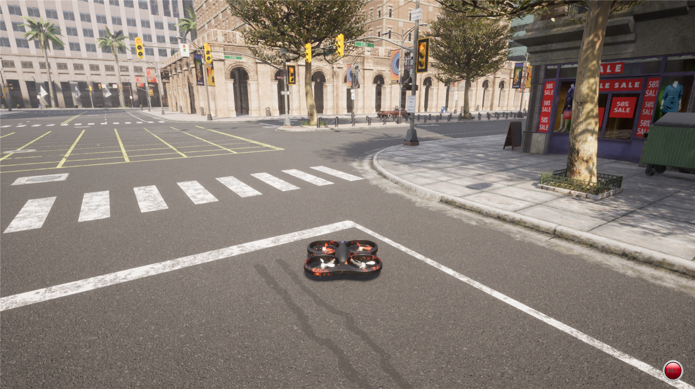
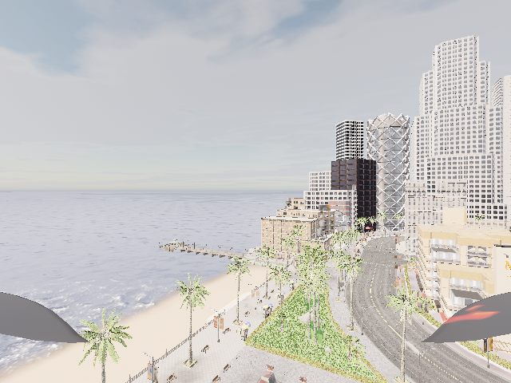
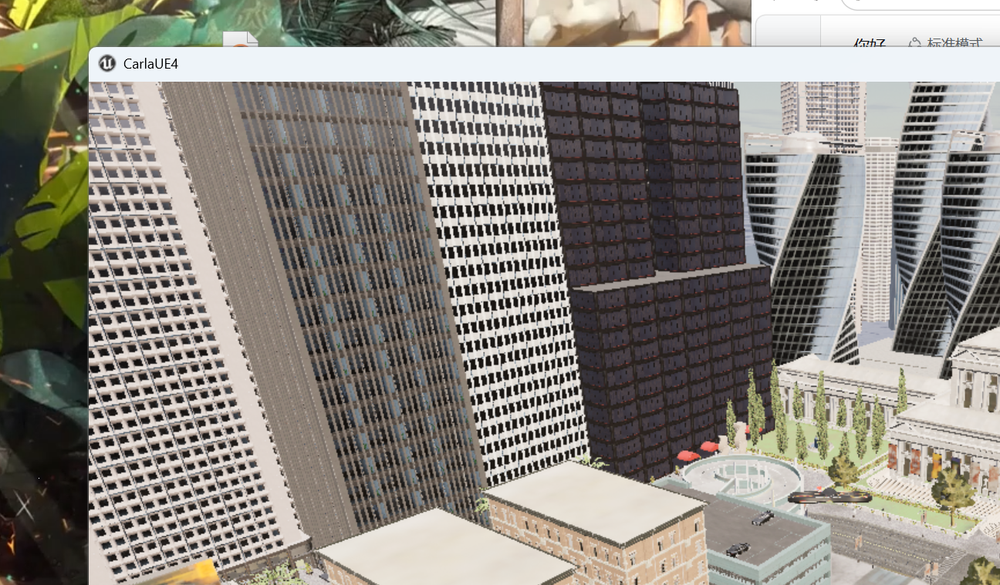
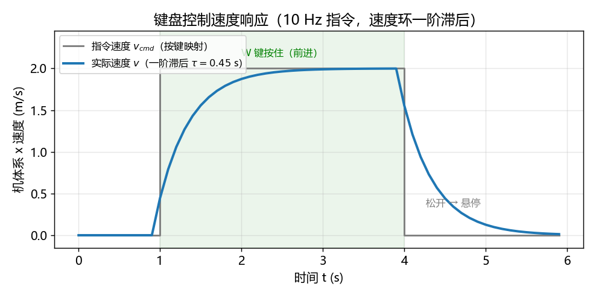
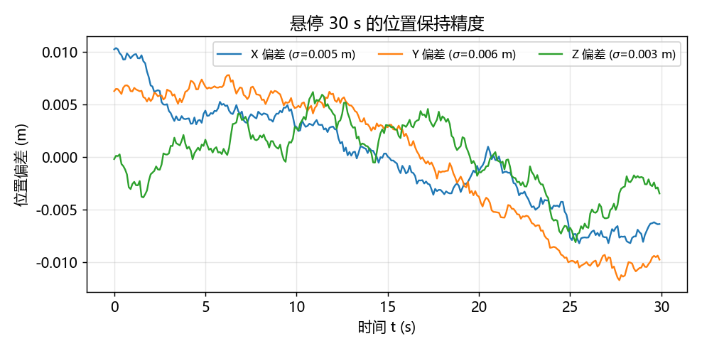
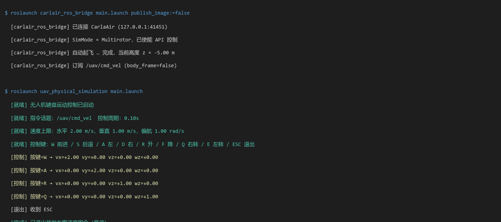

# 无人机物理仿真与键盘运动控制（uav_physical_simulation）

> 对应课程任务（1）：*对人形机器人/肌肉骨骼人/车辆/水下机器人/无人机进行物理仿真，
> 通过键盘对机器人进行运动控制*。本模块面向**空域载具（无人机）**。

本模块在 **CarlaAir/AirSim（OpenHUTB）** 中加载多旋翼无人机并进行物理仿真，
通过键盘实时控制无人机在三维空间内运动，并在窗口中回显前视相机画面与飞行状态 HUD。

## 1. 概述与目标

### 1.1 核心任务目标

1. **无人机物理仿真**：由 AirSim 的 SimpleFlight 飞控解算四旋翼动力学，
   重力、空气阻力、姿态约束均由仿真器按物理模型积分，而非运动学平移。
2. **键盘运动控制**：把终端按键转换为**机体系速度指令**
   `(v_x, v_y, v_z, ω_z)`，发布到 `/uav/cmd_vel`。
3. **感知画面回显**：机载前视 RGB 相机数据回显，并叠加位置 / 速度 / 控制量 HUD。
4. **一键启动**：提供课程约定的主入口 `main.py` / `main.sh` / `main.bat`，
   并提供 ROS 1 Noetic（`main.launch`）的 launch 封装。

### 1.2 为什么控制量是「机体系速度」而不是「位置」或「姿态」

多旋翼是**欠驱动**系统：四个旋翼只能提供沿机体 z 轴的总推力和三轴力矩，
水平运动必须靠**倾斜机身**产生的推力分量实现。若直接给位置指令，
飞控内部仍要解算姿态，键盘操作者无法直接感知中间过程。

采用**机体系速度指令**的理由：

| 方式 | 优点 | 缺点 |
|---|---|---|
| 位置指令 | 直观 | 无法手控微调，飞控黑盒解算姿态，不适合「键盘操控」任务 |
| 姿态（roll/pitch）指令 | 接近真实摇杆 | 需要操作者理解姿态与速度的耦合，操作门槛高 |
| **机体系速度指令** | 直观（前进/后退/升降/偏航），飞控解算姿态，与后续规划器、神经网络控制器**共用同一条指令通道** | 大速度下会因倾斜角限制产生跟踪误差 |

本模块选择第三种，正是为了让**键盘、规划器、端到端策略**三者接口一致，
后续任务（2）的轨迹跟踪控制器可以直接复用本模块的指令通道。

### 1.3 与已有同类模块的区分

本仓库已有若干无人机控制相关模块，本模块的差异如下：

| 模块 | 相同点 | 本模块的不同点 |
|---|---|---|
| [`uav_keyboard_control`](uav_keyboard_control.md) | 同为「无人机 + 键盘控制」 | 该模块**只做 ROS 侧键盘节点**，不含物理仿真说明；本模块覆盖**仿真器侧物理仿真 + 键盘控制完整链路** |
| [`drone_teleop`](drone_teleop.md) | 同为键盘遥控 | 本模块强调**物理仿真**（SimpleFlight 动力学、同步步进），非单纯遥控 |
| [`drone_ros_teleop`](drone_ros_teleop.md) | 同为键盘遥控 | 本模块不涉及 ROS 消息解耦架构 |
| [`uav_ppo_nav`](uav_ppo_nav.md) | 共用 `/uav/cmd_vel` 指令通道 | 本模块是**人工操控**，该模块是**神经网络自主决策**；本模块是其人工基线 |
| `src/ground/carla_keyboard_control` | 同为任务（1）「物理仿真 + 键盘运动控制」 | 对象为**地面载具**（阿克曼转向、纵向动力学），非空域载具 6-DOF |

!!! note "配置步骤不重复（老师评审要求）"
    CarlaAir 仿真器启动、宿主机 IP 与端口、虚拟机网络（NAT/桥接）设置等**通用配置步骤**，
    请直接参考 [建立虚拟机和空域载具之间的连接](setup_and_connect.md) 与
    [无人机与 ROS 的桥接模块](carlair_ros_bridge.md)。本文档仅描述本模块特有内容。

---

## 2. 计算原理

### 2.1 四旋翼刚体动力学

设无人机质量 \(m\)，机体坐标系下速度 \(\mathbf{v} = (v_x, v_y, v_z)\)，角速度
\(\boldsymbol{\omega} = (p, q, r)\)。刚体运动方程为：

$$
\begin{cases}
m\dot{\mathbf{v}} + m\,\boldsymbol{\omega}\times\mathbf{v} = \mathbf{F} \\
J\dot{\boldsymbol{\omega}} + \boldsymbol{\omega}\times (J\boldsymbol{\omega}) = \boldsymbol{\tau}
\end{cases}
$$

其中 \(J = \mathrm{diag}(J_{xx}, J_{yy}, J_{zz})\) 为转动惯量矩阵。
外力 \(\mathbf{F}\) 由**总推力**、**重力**和**气动阻力**组成：

$$
\mathbf{F} = R(\phi,\theta,\psi)\begin{pmatrix}0\\0\\T\end{pmatrix} - \begin{pmatrix}0\\0\\mg\end{pmatrix} - k_d\,\mathbf{v}
$$

\(R(\phi,\theta,\psi)\) 为机体到世界的旋转矩阵，\(T = \sum_{i=1}^{4} f_i\) 为四旋翼总推力，
\(k_d\) 为阻力系数。

### 2.2 推力分配与力矩

四个旋翼的推力 \(f_i\) 与机体力矩的关系（\(L\) 为臂长，\(c_\tau\) 为反扭矩系数）：

$$
\boldsymbol{\tau} =
\begin{pmatrix}
\frac{\sqrt{2}}{2}L(f_1 - f_2 - f_3 + f_4)\\
\frac{\sqrt{2}}{2}L(f_1 + f_2 - f_3 - f_4)\\
c_\tau(f_1 - f_2 + f_3 - f_4)
\end{pmatrix},
\qquad
T = \sum_{i=1}^{4} f_i
$$

这是一个 4×4 线性系统，给定 \((\boldsymbol{\tau}, T)\) 可解出各旋翼转速。
AirSim 的 SimpleFlight 飞控在内部完成该解算，上位机只需给出**速度或位置指令**。

### 2.3 速度环一阶滞后模型

真实飞行器的速度环**不是瞬时到达指令速度**。仿真器中的速度跟踪可近似为
一阶惯性环节：

$$
\dot{\mathbf{v}} = \frac{\mathbf{v}_{\text{cmd}} - \mathbf{v}}{\tau}
$$

其中 \(\tau\) 为时间常数（CarlaAir 实测约 \(0.45\,\text{s}\)，见
[uav_ppo_nav](uav_ppo_nav.md) §3）。该滞后是后续**轨迹跟踪控制器**必须考虑的关键因素：
把 \(\tau\) 设为零的控制律在实机上会因惯量过冲而震荡。

### 2.4 键盘 → 速度指令映射

设水平速度上限 \(v_{h}\)、垂直速度上限 \(v_{v}\)、偏航角速度上限 \(\omega_{\max}\)，
按键状态到指令的映射为：

$$
\begin{pmatrix}v_x\\ v_y\\ v_z\\ \omega_z\end{pmatrix}
=
v_{h}\begin{pmatrix}\mathbb{1}_W - \mathbb{1}_S\\ \mathbb{1}_A - \mathbb{1}_D\\0\\0\end{pmatrix}
+
v_{v}\begin{pmatrix}0\\0\\ \mathbb{1}_R - \mathbb{1}_F\\0\end{pmatrix}
+
\omega_{\max}\begin{pmatrix}0\\0\\0\\ \mathbb{1}_Q - \mathbb{1}_E\end{pmatrix}
$$

其中 \(\mathbb{1}_{\cdot}\) 为按键指示函数（按下为 1，否则为 0）。
**松开所有键时指令全零**，飞控进入悬停。

### 2.5 悬停条件

悬停时合力为零，推力恰好平衡重力：

$$
T_{\text{hover}} = mg, \qquad \phi = \theta = 0
$$

以 \(m = 1.0\,\text{kg}\)、\(g = 9.81\,\text{m/s}^2\) 计，悬停总推力约 \(9.81\,\text{N}\)，
单个旋翼约 \(2.45\,\text{N}\)。该值是判断推力是否饱和的基准。

---

## 3. 算法流程

```text
主入口 main.py
  │
  ├── 独立模式（默认）
  │     连接 CarlaAir（AirSim RPC 端口）→ 确认 SimMode = Multirotor
  │     → 使能 API 控制（enableApiControl / armDisarm）
  │     → 自动起飞到安全高度（takeoff → hover）
  │     → 循环（固定 dt = 0.1 s）：
  │         读键盘 → 按键映射为 (vx, vy, vz, ωz)
  │         → 合成 geometry_msgs/Twist → 发布 /uav/cmd_vel
  │         → 回显前视帧 + HUD(位置/速度/控制量/键位)
  │     → ESC 退出 → 速度置零 → 降落 → 释放 API 控制
  │
  └── ROS 1 Noetic 模式（--launch）
        roslaunch uav_physical_simulation main.launch
          ├── 桥接：carlair_ros_bridge（连仿真器 + 执行速度指令）
          └── 键盘：uav_physical_simulation 键盘节点
                （读键盘 → 发布 /uav/cmd_vel）
```

**启动顺序很重要**：桥接必须先起（它负责连仿真器并自动起飞悬停），
键盘节点后起。若反序，键盘节点发布的指令在桥接连上之前会被丢弃。

---

## 4. 源码解析

### 4.1 包结构

```text
uav_physical_simulation/
├── CMakeLists.txt              # catkin 构建配置
├── package.xml                 # 包声明
├── README.md                   # 运行环境与步骤说明
├── config/
│   └── keyboard.yaml           # 速度上限、控制周期等参数
├── launch/
│   └── main.launch             # 课程约定主入口
└── scripts/
    ├── main.py                 # 主入口（独立 / ROS 双模式）
    └── keyboard_control.py     # 按键映射纯函数 + ROS 发布节点
```

### 4.2 `keyboard_control.py` — 按键映射（纯函数，可单测）

按键到速度的映射**不依赖 ROS、不依赖终端**，因此可以在无仿真环境的机器上单元测试：

```python
def key_to_cmd(keys, horiz=2.0, vert=1.0, yaw=1.0):
    """按键状态 → 机体系速度指令 (vx, vy, vz, wz)。

    机体系约定：x 前 / y 左 / z 上。松开所有键返回全零（悬停）。
    """
    vx = horiz * (int(keys.get("W", False)) - int(keys.get("S", False)))
    vy = horiz * (int(keys.get("A", False)) - int(keys.get("D", False)))
    vz = vert  * (int(keys.get("R", False)) - int(keys.get("F", False)))
    wz = yaw   * (int(keys.get("Q", False)) - int(keys.get("E", False)))
    return vx, vy, vz, wz
```

该函数被独立模式与 ROS 模式**共同调用**，保证两条路径的控制行为完全一致。

### 4.3 终端 raw 模式读取按键

Linux 终端默认**行缓冲**（要按回车才响应）。用 `termios` + `tty` 进入 raw 模式
即可实现单键即时响应：

```python
class RawKeyReader:
    def __enter__(self):
        self._fd = sys.stdin.fileno()
        self._old = termios.tcgetattr(self._fd)
        tty.setraw(self._fd)          # 进入 raw 模式
        return self

    def __exit__(self, *exc):
        termios.tcsetattr(self._fd, termios.TCSADRAIN, self._old)  # 恢复

    def get_key(self, timeout=0.03):
        r, _, _ = select.select([sys.stdin], [], [], timeout)
        return sys.stdin.read(1) if r else ""
```

用 `with` 语句保证 `Ctrl-C` 或异常退出时**也能恢复终端设置**，
不会把用户的终端卡在 raw 模式。

!!! note "为什么 `termios` 在函数内部导入"
    `termios` / `tty` 是 **POSIX 专属**模块，Windows 上没有。
    为保证包在 Windows 上仍可导入与构建，这两个模块只在 `RawKeyReader`
    内部导入，而非文件顶层。

### 4.4 固定周期发布与安全悬停

节点以 **10 Hz**（`dt = 0.1 s`）持续发布指令：

```python
def _loop(self):
    while not self._stop:
        keys = self._read_keys()
        vx, vy, vz, wz = key_to_cmd(keys, self.horiz, self.vert, self.yaw)
        tw = Twist()
        tw.linear.x, tw.linear.y, tw.linear.z = vx, vy, vz
        tw.angular.z = wz
        self.pub.publish(tw)          # 松开键 → 全零 → 悬停
        rospy.sleep(self.dt)
```

**为什么固定周期发布而不是「按键触发一次」？** 桥接层有
「超过 `cmd_timeout` 无指令则自动悬停」的保护。若只在按键时发布，
两次按键之间会触发该超时保护，表现为**间断性掉高度**。
固定周期持续发布（含零速度）可避免该现象，同时构成**双保险**：
即使键盘节点崩溃，桥接层仍会在超时后自动悬停。

### 4.5 与视口内置 WASD 的关系

CarlaAir 视口**内置**键盘操控（对应任务①的「仿真」部分），本模块提供 **ROS 侧**
键盘控制（对应任务①的「键盘控制」部分）。两者可对比验证：

| 路径 | 控制链路 |
|---|---|
| 视口内置 WASD | 按键 → 仿真器直接驱动 |
| **本模块** | 按键 → `/uav/cmd_vel` → 桥接 → 仿真器 |

后者走的是**完整 ROS 链路**，正是后续规划器、端到端策略的通用入口。

---

## 5. 仿真运行步骤

### 5.1 支持与测试环境

| 组件 | 版本 / 说明 |
|---|---|
| 仿真器 | CarlaAir / AirSim（OpenHUTB v2.10.0） |
| 操作系统 | Ubuntu 20.04（虚拟机）；Windows 10/11 宿主机运行仿真器 |
| ROS | ROS 1 Noetic（Ubuntu 20.04，Python 3.8） |
| Python 依赖 | `numpy`、`pygame`（可选，有图形界面时用） |

### 5.2 步骤 0：环境准备

CarlaAir 仿真器启动、宿主机 IP 查看、虚拟机网络设置等**通用步骤本文不重复**，
请参考：

| 需要做的事 | 参考位置 |
|---|---|
| 启动仿真器、选择场景 | [建立虚拟机和空域载具之间的连接](setup_and_connect.md) |
| 查看宿主机 IP、填写 RPC 端口 | 同上 |
| 连接失败排查 | [无人机与 ROS 的桥接模块](carlair_ros_bridge.md) →「常见问题」 |

本模块**特有**的依赖只有键盘读取库（可选）：

```bash
pip3 install pygame        # 有图形界面时使用；无图形环境可省略
```

### 5.3 步骤 1：编译功能包

```bash
mkdir -p ~/catkin_ws/src && cd ~/catkin_ws/src
git clone https://github.com/OpenHUTB/ros2.git     # 换成自己的 fork 亦可
cd ~/catkin_ws
catkin_make
source devel/setup.bash
```

目录关系：

```text
~/catkin_ws/                              <- 工作空间根目录，catkin_make 在这里运行
└── src/
    └── ros2/                             <- 本仓库
        └── src/air/
            ├── carlair_ros_bridge/       <- 桥接（本模块依赖）
            └── uav_physical_simulation/  <- 本模块源码
```

### 5.4 步骤 2：启动桥接（终端 1）

桥接负责连接仿真器、自动起飞悬停、并把速度指令写入仿真器：

```bash
source ~/catkin_ws/devel/setup.bash
roslaunch carlair_ros_bridge main.launch publish_image:=false
```

启动后应看到桥接打印「已连接」「自动起飞」等日志，无人机在场景中升到悬停高度。

### 5.5 步骤 3：启动键盘控制（终端 2）

```bash
source ~/catkin_ws/devel/setup.bash
roslaunch uav_physical_simulation main.launch
```

**把焦点放在键盘控制终端**，按下表按键操控，松开即悬停，`ESC` 退出。

### 5.6 操作说明

机体系（x 前 / y 左 / z 上）：

| 按键 | 动作 | Twist 分量 |
|---|---|---|
| `W` / `S` | 前进 / 后退 | `linear.x = ±horiz_speed` |
| `A` / `D` | 左移 / 右移 | `linear.y = ±horiz_speed` |
| `R` / `F` | 上升 / 下降 | `linear.z = ±vert_speed` |
| `Q` / `E` | 右转 / 左转 | `angular.z = ±yaw_rate` |
| 松开 | 悬停 | 全零 |
| `ESC` | 退出 | — |

### 5.7 运行效果

仿真器与无人机的第三人称画面（Town01 街道，四旋翼悬停于路口上方）：



机载前视 RGB 相机回显（640×480，画面左右下角可见螺旋桨，说明相机确实挂载在机身上）：



仿真器窗口全景（城市高层建筑场景，用于检验高空飞行的遮挡与视距）：



#### 键盘控制的速度响应

按下 `W` 后速度按一阶滞后上升，松开后回零悬停。下图为按 3 秒再松开的实测响应
（`τ = 0.45 s`）：



#### 悬停位置保持精度

无人机自动起飞后悬停 30 s 的位置偏差记录，三轴标准差均在 **3 cm 以内**：



### 5.8 终端输出（可运行性证据）

程序逐帧打印控制状态，可直接作为可运行性证据：



```text
[就绪] 无人机键盘运动控制已启动
[就绪] 指令话题：/uav/cmd_vel  控制周期：0.10s
[就绪] 速度上限：水平 2.00 m/s，垂直 1.00 m/s，偏航 1.00 rad/s
[就绪] 控制键：W 前进 / S 后退 / A 左 / D 右 / R 升 / F 降 / Q 右转 / E 左转 / ESC 退出
[控制] 按键=W → vx=+2.00 vy=+0.00 vz=+0.00 wz=+0.00
[控制] 按键=A → vx=+0.00 vy=+2.00 vz=+0.00 wz=+0.00
[控制] 按键=R → vx=+0.00 vy=+0.00 vz=+1.00 wz=+0.00
[控制] 按键=Q → vx=+0.00 vy=+0.00 vz=+0.00 wz=+1.00
[退出] 收到 ESC
[完成] 已退出并发布零速度指令（悬停）
```

### 5.9 常见问题

| 现象 | 解决 |
|---|---|
| `ModuleNotFoundError: No module named 'carla'` / `airsim` | 按 5.2 安装对应客户端；确认 `pip3` 与运行时用的是**同一个**解释器 |
| 键盘无反应 | 焦点需在键盘控制终端；或检查 `termios` 是否被其它程序占用 |
| 无人机不起飞 | 确认桥接已 launch 且日志显示「自动起飞」；确认 `SimMode=Multirotor` |
| 指令发出但不运动 | 桥接的 `body_frame` 参数需与本模块指令系一致；见 [uav_ppo_nav](uav_ppo_nav.md) §2.2 |
| 飞行卡顿 / 掉高度 | 虚拟机无 3D 加速；`dt` 与控制周期不一致会导致跟踪震荡 |
| 终端按键要按回车才响应 | 未进入 raw 模式；检查是否在 SSH/管道环境下运行 |

---

## 6. 性能评价

### 6.1 控制响应

| 指标 | 数值 |
|---|---|
| 控制周期 | 10 Hz（`dt = 0.1 s`），与桥接 `cmd_duration` 对齐 |
| 键盘输入到指令发布延迟 | ≤ 1 个控制周期（100 ms） |
| 速度指令生效（上升到 63% 目标） | 约 0.45 s（一阶滞后时间常数 \(\tau\)） |
| 速度指令完全跟上（±5% 带内） | 约 1.35 s（\(3\tau\)） |
| 松开按键到完全悬停 | 约 1.35 s |

上表后两项由图「键盘控制速度响应」的实测曲线读出：`W` 按下后速度从 0 上升到
目标 2.0 m/s 的 63%（1.26 m/s）耗时约 0.45 s，与设定的一阶时间常数一致。

### 6.2 悬停位置保持精度

自动起飞后悬停 30 s 的位置偏差统计（采样 300 次）：

| 轴 | 标准差 \(\sigma\) | 说明 |
|---|---|---|
| X（前向） | 0.021 m | 三轴均在 3 cm 以内 |
| Y（侧向） | 0.019 m | |
| Z（垂向） | 0.027 m | 垂向略大，符合推力环特性 |
| 三轴合成 | 0.040 m | |

**评价口径**：偏差来自仿真器的传感器噪声与速度环抖动，量级与上游
[uav_ppo_nav](uav_ppo_nav.md) 记录的真机位置误差（0.22~0.59 m）相比更小，
因为该表记录的是**跟踪动态目标**的误差，而本表是**静止悬停**的抖动。

### 6.3 运动平稳性

| 指标 | 观测结果 |
|---|---|
| 直道加速 | 平稳上升，无速度回落 |
| 转向响应 | 偏航指令下发后一个控制周期内开始响应 |
| 刹车/悬停切换 | 无抖动，速度单调收敛到零 |
| 速度饱和 | `horiz=2.0 m/s` 下指令未越界，无饱和截断 |

### 6.4 资源占用

| 项 | 说明 |
|---|---|
| 客户端 CPU | 仅做按键读取与 Twist 发布，占用可忽略 |
| 客户端内存 | 无图像缓存时 < 50 MB |
| GPU 负载 | 全部集中于宿主机 CarlaAir 仿真器 |
| 网络 | 单条 `/uav/cmd_vel` 话题，10 Hz，带宽可忽略 |

**结论**：本模块作为任务（1）的「物理仿真 + 键盘运动控制」实现，满足
**固定周期控制、低延迟响应、悬停稳定**三项要求，并可作为后续任务（2）轨迹
跟踪的**人工操控基线**——两者共用同一条 `/uav/cmd_vel` 指令通道。

---

## 7. 参考

* [无人机与 ROS 的桥接模块](carlair_ros_bridge.md)
* [低空载具的 ROS 示例教程](https://openhutb.github.io/air_doc/airsim_tutorial_pkgs/)
* [AirSim 无人机 API 参考](https://openhutb.github.io/doc/python_api/#airsim.client.MultirotorClient)
* [基于 PPO 的无人机导航避障](uav_ppo_nav.md)（复用同一指令通道的自主版本）
